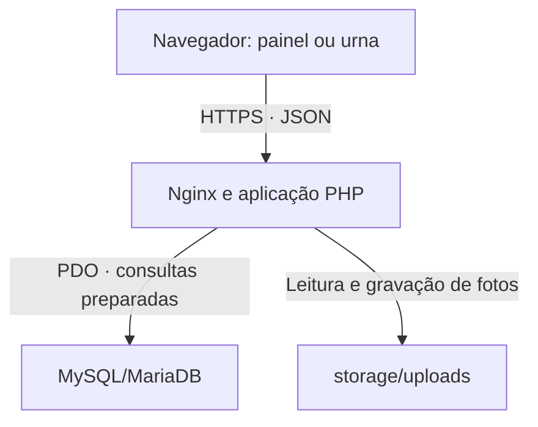

# Urna Santa Inês — especificação do banco e da comunicação

Verificação em 30/10/2026. Base: pacote Urna-Santa-Ines-V2-Alfa.zip, versão 9, e código do ambiente de testes publicado, versão 10, commit `c235e68e5f3504f7f77c6671a7e42a0396bc90c5`.

Esta é a descrição da implementação atual. O servidor CloudPanel da escola não foi inspecionado nem alterado nesta consulta. Nome do banco, usuário e host reais dependem da configuração desse servidor.

## 1. Dois ambientes separados

| Característica          | Pacote para o CloudPanel                              | Link de testes hospedado                              |
| ----------------------- | ----------------------------------------------------- | ----------------------------------------------------- |
| Interface               | React/TypeScript compilado em JavaScript e CSS        | A mesma interface, com adaptador próprio de servidor  |
| Servidor da aplicação   | PHP, acessando MySQL por PDO                          | TypeScript em Cloudflare Workers/Vinext               |
| Banco                   | MySQL/MariaDB, tabelas relacionais                    | Cloudflare D1, compatível com SQLite                  |
| Organização dos dados   | 21 tabelas no conjunto completo; 10 têm prefixo `v2_` | 3 tabelas SQL; o estado principal é um documento JSON |
| Fotos enviadas          | Arquivos em `storage/uploads`, fora de `public`       | Objetos no bucket R2                                  |
| Conexão entre ambientes | Não implementada                                      | Não implementada                                      |

Os dados cadastrados no link de testes não são enviados automaticamente ao MySQL da escola. O projeto também não está conectado ao sistema de gestão escolar: a entrada de alunos ocorre por CSV ou cadastro manual.

No CloudPanel, a V2 usa um banco central para as urnas e eleições. Cada eleição tem seus candidatos, eleitores e vínculos com urnas. Não se cria um banco por urna ou por eleição.

## 2. Comunicação no CloudPanel



1. O navegador abre o painel ou a urna e carrega os arquivos compilados de `public`.
2. A interface usa `fetch` para consultar ou enviar JSON aos caminhos `/api/...` do mesmo domínio.
3. O PHP valida origem, sessão/permissões ou autorização de votação, e executa SQL parametrizado com PDO.
4. O banco devolve registros; o PHP monta JSON e a interface atualiza a tela.
5. Fotos são buscadas pela rota `/api/images/ID`. O banco guarda a referência da imagem; o arquivo fica no armazenamento.

CloudPanel gerencia o site, PHP, HTTPS e banco. A raiz do domínio deve ser `public`; `server`, `database`, `config` e `storage` ficam fora da raiz pública. O navegador não recebe usuário ou senha do MySQL e não se conecta à porta do banco.

A conexão está em `config/config.php`, ou em um arquivo apontado por `URNA_CONFIG`. O exemplo do pacote usa host `127.0.0.1`, porta `3306` e banco `urna_escolar`; esses valores são exemplos. Com o banco no mesmo servidor, o trajeto de PDO até MySQL é local. A conexão não configura TLS próprio para um banco remoto.

O painel consulta o estado a cada 20 segundos, quando não há operação em andamento, e após salvar uma alteração. A urna consulta a configuração a cada 10 segundos. A autorização e a confirmação do voto são verificadas no servidor a cada envio. Não há WebSocket nem fila de votação offline implementados.

## 3. Tipos, chaves e convenções

- **PK / PRIMARY KEY:** identifica uma linha, sem repetição nem valor nulo.
- **FK / FOREIGN KEY:** exige que o identificador relacionado exista na tabela referenciada.
- **UNIQUE:** impede repetição de um campo ou combinação de campos.
- **Chave composta:** usa dois ou mais campos juntos para identificar a linha.
- Eleições, candidatos e votos usam `CHAR(36)` para UUID. Os novos IDs gerados pelo servidor são UUID v4; o ID de confirmação do voto vem do cliente e é validado pelo PHP como UUID v4.
- Não há `AUTO_INCREMENT` no esquema atual. Matrícula e nomes anteriores de turmas são chaves naturais; as urnas têm identificadores textuais estáveis.
- Matrícula é `VARCHAR(80)`: mantém zeros e aceita letras, números e os símbolos `.`, `_`, `/`, `-`, começando por letra ou número.
- O número de candidato é `VARCHAR(5)`, separado do ID interno. A regra da aplicação aceita de `0` a `99999`, respeitando o limite da eleição e sem zeros à esquerda como `01`.
- `TINYINT` representa os indicadores 0/1. Valores permitidos são validados pelo PHP; não há `CHECK` ou `ENUM` nessas colunas.
- As tabelas da aplicação usam InnoDB, `utf8mb4` e `utf8mb4_bin`. A tabela `schema_migrations` declara apenas InnoDB, herdando charset/collation do banco. A collation binária diferencia maiúsculas e minúsculas.
- Datas de eleições e sessões são texto ISO 8601 UTC, com milissegundos, em `VARCHAR(24)`. A conexão configura fuso UTC. `gate_expires` usa Unix timestamp em segundos.
- Alguns campos `LONGTEXT` contêm JSON. O tipo SQL não valida esse JSON; a aplicação faz codificação e leitura.
- As FKs declaradas não usam `ON DELETE CASCADE` nem `ON UPDATE CASCADE`. O esquema não define triggers ou procedures.

## 4. Modelo central da V2

| Tabela                  | Chave primária               | Papel                                                     |
| ----------------------- | ---------------------------- | --------------------------------------------------------- |
| `v2_students`           | `matricula`                  | Cadastro geral de alunos e situação ativa                 |
| `v2_elections`          | `id`                         | Configuração da eleição e cópia dos candidatos publicados |
| `v2_candidates`         | `id`                         | Candidato e vice vinculados à eleição                     |
| `v2_electors`           | `(election_id, matricula)`   | Lista da eleição, participação e liberação temporária     |
| `v2_terminals`          | `id`                         | Identificação e modelo das urnas                          |
| `v2_election_terminals` | `(election_id, terminal_id)` | Relação entre várias eleições e várias urnas              |
| `v2_accounts`           | `admin_id`                   | Nome de usuário, permissões e escopos da conta            |
| `v2_election_owners`    | `election_id`                | Responsável pela eleição                                  |
| `v2_class_aliases`      | `original_name`              | Nome anterior e nome atual da turma                       |
| `v2_ballots`            | `id`                         | Votos, sem matrícula ou nome de eleitor                   |

### Alunos, turmas e eleitorado

`v2_students` é o cadastro geral. Cada matrícula tem nome, turma e situação. As turmas são calculadas com `GROUP BY class_name` sobre os alunos ativos. Hoje não existe uma tabela de turmas com `turma_id`.

Ao selecionar as turmas na eleição, a aplicação copia matrícula, nome e turma para `v2_electors`. Essa é a lista própria da eleição. Alterar o cadastro geral não reescreve automaticamente listas já salvas. Nos rascunhos, Atualizar alunos das turmas refaz a seleção; a operação exige que haja alunos ativos na seleção. A lista publicada fica protegida contra edição.

A chave composta `(election_id, matricula)` permite que a matrícula `001234` apareça uma vez na eleição A e uma vez na eleição B. O vínculo para `v2_students.matricula` é uma FK real.

Excluir aluno significa atualizar `active=0`, mantendo a linha para preservar seus vínculos. Ele sai das listas do cadastro ativo e de novas seleções. Eleitorados e votos já existentes permanecem. Cadastrar ou importar a mesma matrícula a reativa, sem apagar a participação anterior. A matrícula vinculada a qualquer eleição fica protegida contra alteração; nome e turma gerais continuam editáveis.

Renomear uma turma atualiza o cadastro geral e registra o nome anterior em `v2_class_aliases`. O código resolve esses nomes para manter as permissões e reconhecer importações antigas. O nome salvo nas listas publicadas é mantido.

### Eleições, candidatos e vice

A FK `v2_candidates.election_id` aponta para `v2_elections.id`. O índice único `(election_id, code)` impede dois candidatos com o mesmo número na mesma eleição. Outra eleição pode reutilizar esse número.

O vice está na mesma linha do candidato, nos campos `vice_name` e `vice_image`; não possui ID ou tabela próprios. A coluna `has_vice` da eleição determina se o cadastro exige vice. A aplicação permite seis chapas ou mais; o banco não fixa um limite de seis.

Publicar valida período, candidatos, eleitores quando a matrícula é exigida, modelos de urna e fotos necessárias. A publicação grava uma cópia dos candidatos em `candidate_snapshot`. A tela de votação e a validação do código usam essa cópia. Nome, regras, candidaturas e eleitorado publicados ficam protegidos no fluxo normal; uma nova configuração é preparada duplicando a eleição.

O status é calculado a partir de `published`, `closed`, `starts_at` e `ends_at`: rascunho, agendada, aberta ou encerrada. Não existe coluna `status` na tabela.

### Mesma urna, várias eleições

`v2_election_terminals` materializa a relação N:N. Uma urna pode aparecer em vários vínculos e uma eleição pode ser vinculada a ambos os modelos. A chave composta impede apenas repetir o mesmo par.

Os IDs usados pelo fluxo atual são `urna-padrao` e `urna-infantil`. Seus modelos são `standard` e `images`. O campo antigo `v2_terminals.election_id` continua reconhecido por compatibilidade; o fluxo atual de publicação usa a tabela de vínculos.

O registro da urna representa um endereço/modelo lógico, sem identificação exclusiva de equipamento físico. Mais de um computador ou iPad pode abrir o mesmo endereço. Eleições e matrículas continuam validadas no servidor.

### Votos e resultados

`v2_ballots` contém somente `id`, `election_id`, `candidate_id` e `kind`. O fluxo atual grava `kind='valid'` e recusa branco, nulo e número inexistente. A contagem usa `COUNT(*) GROUP BY candidate_id`, filtrado por eleição. Candidatos sem linhas de voto começam com zero; não existe coluna de votos acumulados no cadastro do candidato.

A linha do voto não contém nome, matrícula, turma, terminal ou data/hora. A participação fica separada em `v2_electors.voted`. Essa separação evita um vínculo direto entre eleitor e escolha nessas tabelas; não é um mecanismo de voto criptográfico ponta a ponta.

`v2_ballots.election_id` é FK real. `candidate_id` não possui FK no DDL: o PHP confirma que o candidato pertence ao `candidate_snapshot` da eleição. `v2_electors.terminal_id` também é validado pelo código, sem FK SQL.

## 5. Autorização e confirmação do voto

1. A urna consulta suas eleições. Com uma eleição disponível ela é selecionada automaticamente; com várias, o aluno escolhe.
2. O aluno informa matrícula. O PHP consulta `v2_electors` pela chave eleição + matrícula e verifica eleição aberta, vínculo com a urna, participação e liberação existente.
3. O servidor gera um token aleatório de 32 bytes, representado em 43 caracteres, e entrega o token ao navegador. No banco fica apenas o SHA-256, em `gate_hash`.
4. A liberação dura 300 segundos e fica vinculada à eleição e ao ID da urna. O banco registra `gate_expires` e `terminal_id`. Não se cria uma senha permanente do aluno.
5. Na confirmação, o navegador envia o ID da eleição, o número escolhido, o token e um `requestId` aleatório. A matrícula não é um campo do registro do voto.
6. Em transação, o PHP trava eleição, urna e eleitor com `SELECT ... FOR UPDATE`, confere a liberação, grava `voted=1`, limpa a liberação e insere o voto.
7. Se a transação falha, as alterações são revertidas. Confirmações simultâneas são serializadas pelos bloqueios. O `requestId`, PK de `v2_ballots`, também torna o reenvio da mesma confirmação idempotente: ele retorna sucesso sem outro voto quando eleição e candidato coincidem.

O bloqueio de repetição combina a chave composta do eleitor, o campo `voted`, as validações e a transação. Excluir e recadastrar a matrícula mantém esse bloqueio para a mesma eleição. Para outra eleição há outro registro de eleitor.

A verificação por matrícula confirma que o número está habilitado; não exige senha individual nem comprova por si só a identidade de quem digitou o número. O modo de demonstração sem matrícula é previsto por `require_matricula=0` e não possui controle individual de participação.

## 6. Contas, permissões e sessões

A identidade fica em `administrators`, o hash da senha em `admin_passwords` e os acessos em `v2_accounts`. O responsável por cada eleição fica em `v2_election_owners`.

| Campo de permissão | Ações liberadas                                                               |
| ------------------ | ----------------------------------------------------------------------------- |
| `manageElections`  | Criar/editar eleição e candidatos, fotos e duplicação                         |
| `manageVoters`     | Selecionar turmas, consultar eleitores, imprimir títulos e cancelar liberação |
| `publishElections` | Publicar, agendar e encerrar                                                  |
| `viewResults`      | Consultar/exportar resultados                                                 |

`role='admin'` libera as funções administrativas. A equipe recebe as permissões marcadas e acessa eleições próprias ou atribuídas. `class_scope` contém JSON `null` para todas as turmas ou uma lista de nomes permitidos. `election_ids` guarda em JSON as eleições adicionais atribuídas. Esses elementos JSON são validados pelo código; não são FKs individuais.

Importar, cadastrar, editar, renomear turma, excluir aluno e gerenciar contas exigem administrador. As permissões são verificadas no servidor, mesmo em chamadas diretas à API. Alterações de escopo valem nas solicitações seguintes.

As senhas passam por SHA-256 e depois `password_hash(..., PASSWORD_DEFAULT)`, com prefixo de versão `s1:`; são verificadas com `password_verify`. Não são guardadas em texto simples. A senha da conta, a senha do MySQL e a do CloudPanel são credenciais diferentes.

A sessão dura 12 horas. Seu token fica em cookie HttpOnly, Secure em HTTPS, SameSite=Lax; o banco guarda o hash. O painel exige também uma chave da aba, cujo hash fica em `panel_hash`; a chave é enviada no cabeçalho `X-Urna-Panel`. Alteração de senha incrementa a versão e invalida sessões anteriores. Desativação também invalida as sessões.

POSTs exigem `Origin` igual ao domínio configurado. O PHP utiliza consultas preparadas, transações e limites de requisição. Os limites de tentativas desta versão PHP ficam em arquivos com bloqueio em `storage/login-limits`; a tabela antiga `login_limits` permanece no esquema.

## 7. Contrato principal da API

| Método e caminho       | Uso                                                            |
| ---------------------- | -------------------------------------------------------------- |
| `POST /api/auth`       | Ações `login`, `logout`, `password`                            |
| `GET /api/v2/app`      | Estado do painel filtrado por conta/permissões                 |
| `POST /api/v2/app`     | Ações administrativas descritas abaixo                         |
| `GET /api/v2/urna/ID`  | Modelos e eleições disponíveis; `?election=UUID` seleciona uma |
| `POST /api/v2/urna/ID` | `authorize`, `vote` e `cancel`                                 |
| `GET /api/images/ID`   | Entrega de foto autorizada                                     |
| `POST /api/images`     | Upload multipart administrativo, além da ação `image` da V2    |

Ações de `/api/v2/app`: `student`, `deleteStudent`, `renameClass`, `account`, `election`, `candidate`, `terminal`, `image`, `csvPreview`, `csvImport`, `enroll`, `publish`, `electors`, `unlock`, `close`, `duplicate`.

Os objetos JSON usam nomes como `className`, `electionId` e `viceName`; no SQL os campos correspondentes são `class_name`, `election_id` e `vice_name`. O PHP faz esse mapeamento. A API responde JSON e usa `Cache-Control: no-store` para respostas de dados.

Exemplo ilustrativo de cadastro manual:

```json
{
  "action": "student",
  "value": {
    "name": "Aluno de exemplo",
    "matricula": "001234",
    "className": "6A"
  }
}
```

Exemplo ilustrativo de autorização enviado ao endereço da urna:

```json
{
  "action": "authorize",
  "electionId": "UUID_DA_ELEICAO",
  "matricula": "001234"
}
```

A resposta inclui `gate`, `name`, `className` e `expiresIn=300`. O token deve ser tratado como temporário e não incluído em relatórios ou logs.

Exemplo ilustrativo de confirmação:

```json
{
  "action": "vote",
  "electionId": "UUID_DA_ELEICAO",
  "code": "12",
  "gate": "TOKEN_TEMPORARIO",
  "requestId": "UUID_V4_DA_CONFIRMACAO"
}
```

A API pode responder 400 (dados inválidos), 401 (sessão ausente/expirada), 403 (acesso/eleitor não autorizado), 404 (registro ausente), 409 (conflito ou participação já registrada), 413 (tamanho), 415 (tipo de conteúdo), 429 (tentativas), 500 (falha interna) ou 503 (configuração/conexão indisponível).

## 8. Limites atuais e arquivos

| Item                            | Implementação atual                                                     |
| ------------------------------- | ----------------------------------------------------------------------- |
| CSV de alunos                   | UTF-8, colunas `nome`, `turma`, `matricula`; vírgula ou ponto e vírgula |
| Tamanho de CSV                  | Até 1.500.000 bytes por importação                                      |
| Quantidade por CSV              | De 1 a 10.000 alunos; não representa limite total da base               |
| Nome de aluno/candidato/eleição | Até 160 caracteres                                                      |
| Matrícula / turma               | Até 80 caracteres                                                       |
| Número de candidato             | 1 a 5 dígitos, conforme eleição; `0` permitido, `01` recusado           |
| Usuário de painel               | 3 a 80 caracteres ASCII: letras minúsculas, números, `.`, `_`, `-`      |
| Senha de painel                 | 10 a 128 caracteres                                                     |
| Seleção/escopo de turmas        | Até 500 itens por requisição/configuração                               |
| Eleições adicionais por conta   | Até 1.000 IDs                                                           |
| Fotos no PHP                    | PNG/JPEG/WebP, até 2 MiB; até 6.000 px por lado e 20 megapixels         |
| Referência da foto no SQL       | `VARCHAR(250)`                                                          |
| Liberação de matrícula          | 5 minutos                                                               |
| Sessão administrativa           | 12 horas                                                                |

Importar uma matrícula existente atualiza nome/turma e ativa o cadastro. Ausência no CSV não exclui o aluno. Cadastros manuais ativos duplicados são recusados. Não há integração automática de matrícula, sincronização de alunos externos ou processamento de planilha XLSX implementados.

O POST da API V2 PHP aceita até 2.200.000 bytes de corpo JSON. Como o painel envia fotos em base64, esse limite pode recusar fotos abaixo dos 2 MiB permitidos pela rotina de arquivo; o máximo efetivo por esse caminho fica próximo de 1,65 milhão de bytes, descontando o envelope JSON. A rota multipart tem limite de arquivo de 2 MiB. O adaptador hospedado aceita corpo de até 2.850.000 bytes. Esta diferença já existe no código atual e não foi alterada nesta documentação.

Não há trilha completa de auditoria de edição/exclusão de alunos, nem datas de criação/alteração nas tabelas V2 de cadastro. A coluna `active` preserva o cadastro excluído; isso não é uma lixeira com histórico de versões. Não foi definido um limite de capacidade por teste de carga nesta consulta.

O pacote não exige Node.js no CloudPanel para executar a aplicação, pois a interface já vai compilada. O código PHP verifica `pdo_mysql`, `mbstring`, `openssl` e `fileinfo`; requer escrita em `storage` e `storage/uploads`. O conjunto foi testado em PHP 8.3/MariaDB 10.11, com 184 verificações HTTP; o adaptador hospedado teve 157 verificações. Isso valida os cenários funcionais testados, sem constituir medição de capacidade.

## 9. Migrações e tabelas preservadas

As cinco migrações SQL são registradas em `schema_migrations` e executadas uma vez pela aplicação, sob bloqueio de instalação. O banco deve existir e o usuário da aplicação precisa das permissões necessárias para criar as tabelas e ler/gravar dados.

- `001_initial.sql`: estrutura anterior e autenticação compartilhada.
- `002_elections_v2.sql`: eleições, candidatos, alunos, urnas, eleitores e votos V2.
- `003_shared_terminals.sql`: relação entre urnas e eleições.
- `004_team_access.sql`: contas e responsáveis por eleição.
- `005_class_names.sql`: reconhecimento de nomes de turmas renomeadas.

As tabelas anteriores `terminals`, `candidates`, `elections` e `ballots` guardam a versão antiga. Os dados antigos não são convertidos automaticamente em eleições V2. A autenticação reutiliza parte das tabelas anteriores. `admin_invitations`, `mail_configuration` e `login_limits` permanecem no esquema; o fluxo V2 atual usa usuário/senha local e não envio de convite/SMTP.

A cópia do banco precisa ser acompanhada das fotos em `storage/uploads` e dos arquivos de configuração necessários para restaurar o site.

## 10. Integridade efetivamente declarada no SQL

As tabelas abaixo apresentam o DDL exato e suas colunas. A lista registra o que o banco impõe; regras adicionais descritas nas seções anteriores são aplicadas pelo servidor PHP.

### database/001_initial.sql

#### schema_migrations

Migrações SQL já aplicadas.

PK: `version`.

| Coluna       | Tipo SQL      | Aceita NULL | Definição e restrições locais |
| ------------ | ------------- | ----------- | ----------------------------- |
| `version`    | `VARCHAR(80)` | Não         | `PRIMARY KEY`                 |
| `applied_at` | `VARCHAR(24)` | Não         | `NOT NULL`                    |

Restrições/índices da tabela:

- As restrições estão nas definições das colunas.

#### terminals

Urnas da versão anterior.

PK: `id`.

| Coluna     | Tipo SQL       | Aceita NULL | Definição e restrições locais |
| ---------- | -------------- | ----------- | ----------------------------- |
| `id`       | `VARCHAR(160)` | Não         | `PRIMARY KEY`                 |
| `name`     | `VARCHAR(160)` | Não         | `NOT NULL`                    |
| `location` | `VARCHAR(160)` | Não         | `NOT NULL DEFAULT ''`         |
| `model`    | `VARCHAR(16)`  | Não         | `NOT NULL`                    |

Restrições/índices da tabela:

- As restrições estão nas definições das colunas.

#### candidates

Candidatos da versão anterior.

PK: `id`.

| Coluna        | Tipo SQL       | Aceita NULL | Definição e restrições locais |
| ------------- | -------------- | ----------- | ----------------------------- |
| `id`          | `VARCHAR(160)` | Não         | `PRIMARY KEY`                 |
| `terminal_id` | `VARCHAR(160)` | Sim         | `NULL`                        |
| `name`        | `VARCHAR(160)` | Não         | `NOT NULL`                    |
| `code`        | `CHAR(2)`      | Não         | `NOT NULL`                    |
| `image`       | `VARCHAR(250)` | Não         | `NOT NULL DEFAULT ''`         |
| `active`      | `TINYINT`      | Não         | `NOT NULL DEFAULT 1`          |

Restrições/índices da tabela:

- `UNIQUE KEY candidates_terminal_code_unique (terminal_id,code)`
- `FOREIGN KEY (terminal_id) REFERENCES terminals(id)`

#### elections

Eleições da versão anterior.

PK: `id`.

| Coluna               | Tipo SQL       | Aceita NULL | Definição e restrições locais |
| -------------------- | -------------- | ----------- | ----------------------------- |
| `id`                 | `VARCHAR(160)` | Não         | `PRIMARY KEY`                 |
| `name`               | `VARCHAR(160)` | Não         | `NOT NULL`                    |
| `terminal_id`        | `VARCHAR(160)` | Não         | `NOT NULL`                    |
| `starts_at`          | `VARCHAR(24)`  | Não         | `NOT NULL`                    |
| `ends_at`            | `VARCHAR(24)`  | Não         | `NOT NULL`                    |
| `closed`             | `TINYINT`      | Não         | `NOT NULL DEFAULT 0`          |
| `archived`           | `TINYINT`      | Não         | `NOT NULL DEFAULT 0`          |
| `candidate_snapshot` | `LONGTEXT`     | Não         | `NOT NULL`                    |
| `digits`             | `TINYINT`      | Não         | `NOT NULL DEFAULT 2`          |

Restrições/índices da tabela:

- `INDEX elections_terminal_period (terminal_id,closed,starts_at,ends_at)`
- `FOREIGN KEY (terminal_id) REFERENCES terminals(id)`

#### ballots

Votos da versão anterior.

PK: `id`.

| Coluna         | Tipo SQL       | Aceita NULL | Definição e restrições locais |
| -------------- | -------------- | ----------- | ----------------------------- |
| `id`           | `CHAR(36)`     | Não         | `PRIMARY KEY`                 |
| `election_id`  | `VARCHAR(160)` | Não         | `NOT NULL`                    |
| `candidate_id` | `VARCHAR(160)` | Não         | `NOT NULL`                    |
| `kind`         | `VARCHAR(16)`  | Não         | `NOT NULL`                    |

Restrições/índices da tabela:

- `INDEX ballots_results (election_id,candidate_id,kind)`
- `FOREIGN KEY (election_id) REFERENCES elections(id)`

#### administrators

Identidade, papel e situação das contas.

PK: `id`.

| Coluna   | Tipo SQL       | Aceita NULL | Definição e restrições locais |
| -------- | -------------- | ----------- | ----------------------------- |
| `id`     | `VARCHAR(160)` | Não         | `PRIMARY KEY`                 |
| `name`   | `VARCHAR(160)` | Não         | `NOT NULL`                    |
| `email`  | `VARCHAR(254)` | Não         | `NOT NULL UNIQUE`             |
| `role`   | `VARCHAR(16)`  | Não         | `NOT NULL DEFAULT 'admin'`    |
| `active` | `TINYINT`      | Não         | `NOT NULL DEFAULT 1`          |
| `owner`  | `TINYINT`      | Não         | `NOT NULL DEFAULT 0`          |

Restrições/índices da tabela:

- As restrições estão nas definições das colunas.

#### admin_passwords

Hash e versão da senha por conta.

PK: `admin_id`.

| Coluna       | Tipo SQL       | Aceita NULL | Definição e restrições locais |
| ------------ | -------------- | ----------- | ----------------------------- |
| `admin_id`   | `VARCHAR(160)` | Não         | `PRIMARY KEY`                 |
| `hash`       | `VARCHAR(255)` | Não         | `NOT NULL`                    |
| `version`    | `INT`          | Não         | `NOT NULL DEFAULT 1`          |
| `updated_at` | `VARCHAR(24)`  | Não         | `NOT NULL`                    |

Restrições/índices da tabela:

- `FOREIGN KEY (admin_id) REFERENCES administrators(id)`

#### admin_sessions

Sessões de acesso ao painel.

PK: `id`.

| Coluna       | Tipo SQL       | Aceita NULL | Definição e restrições locais |
| ------------ | -------------- | ----------- | ----------------------------- |
| `id`         | `CHAR(64)`     | Não         | `PRIMARY KEY`                 |
| `admin_id`   | `VARCHAR(160)` | Não         | `NOT NULL`                    |
| `version`    | `INT`          | Não         | `NOT NULL`                    |
| `expires_at` | `VARCHAR(24)`  | Não         | `NOT NULL`                    |
| `panel_hash` | `CHAR(64)`     | Não         | `NOT NULL`                    |

Restrições/índices da tabela:

- `INDEX sessions_expiry (expires_at)`
- `FOREIGN KEY (admin_id) REFERENCES administrators(id)`

#### admin_invitations

Convites antigos; mantidos por compatibilidade.

PK: `id`.

| Coluna              | Tipo SQL       | Aceita NULL | Definição e restrições locais |
| ------------------- | -------------- | ----------- | ----------------------------- |
| `id`                | `CHAR(36)`     | Não         | `PRIMARY KEY`                 |
| `admin_id`          | `VARCHAR(160)` | Não         | `NOT NULL`                    |
| `token_hash`        | `CHAR(64)`     | Não         | `NOT NULL UNIQUE`             |
| `expires_at`        | `VARCHAR(24)`  | Não         | `NOT NULL`                    |
| `used`              | `TINYINT`      | Não         | `NOT NULL DEFAULT 0`          |
| `delivery`          | `VARCHAR(20)`  | Não         | `NOT NULL`                    |
| `created_at`        | `VARCHAR(24)`  | Não         | `NOT NULL`                    |
| `replacement_email` | `VARCHAR(254)` | Sim         | `NULL`                        |
| `replacement_name`  | `VARCHAR(160)` | Sim         | `NULL`                        |

Restrições/índices da tabela:

- `INDEX invitations_admin (admin_id,created_at)`
- `FOREIGN KEY (admin_id) REFERENCES administrators(id)`

#### login_limits

Estrutura antiga de limite de tentativas; PHP atual usa arquivos.

PK: `id`.

| Coluna        | Tipo SQL      | Aceita NULL | Definição e restrições locais |
| ------------- | ------------- | ----------- | ----------------------------- |
| `id`          | `CHAR(64)`    | Não         | `PRIMARY KEY`                 |
| `attempts`    | `INT`         | Não         | `NOT NULL`                    |
| `window_ends` | `VARCHAR(24)` | Não         | `NOT NULL`                    |

Restrições/índices da tabela:

- As restrições estão nas definições das colunas.

#### mail_configuration

Configuração antiga de e-mail; não usada no fluxo V2 atual.

PK: `id`.

| Coluna               | Tipo SQL       | Aceita NULL | Definição e restrições locais |
| -------------------- | -------------- | ----------- | ----------------------------- |
| `id`                 | `VARCHAR(20)`  | Não         | `PRIMARY KEY`                 |
| `sender`             | `VARCHAR(254)` | Não         | `NOT NULL`                    |
| `encrypted_settings` | `TEXT`         | Não         | `NOT NULL`                    |
| `updated_at`         | `VARCHAR(24)`  | Não         | `NOT NULL`                    |

Restrições/índices da tabela:

- As restrições estão nas definições das colunas.

SQL original:

```sql
CREATE TABLE IF NOT EXISTS schema_migrations (version VARCHAR(80) PRIMARY KEY, applied_at VARCHAR(24) NOT NULL) ENGINE=InnoDB;
CREATE TABLE IF NOT EXISTS terminals (
 id VARCHAR(160) PRIMARY KEY, name VARCHAR(160) NOT NULL, location VARCHAR(160) NOT NULL DEFAULT '', model VARCHAR(16) NOT NULL
) ENGINE=InnoDB DEFAULT CHARSET=utf8mb4 COLLATE=utf8mb4_bin;
CREATE TABLE IF NOT EXISTS candidates (
 id VARCHAR(160) PRIMARY KEY, terminal_id VARCHAR(160) NULL, name VARCHAR(160) NOT NULL, code CHAR(2) NOT NULL,
 image VARCHAR(250) NOT NULL DEFAULT '', active TINYINT NOT NULL DEFAULT 1,
 UNIQUE KEY candidates_terminal_code_unique (terminal_id,code), FOREIGN KEY (terminal_id) REFERENCES terminals(id)
) ENGINE=InnoDB DEFAULT CHARSET=utf8mb4 COLLATE=utf8mb4_bin;
CREATE TABLE IF NOT EXISTS elections (
 id VARCHAR(160) PRIMARY KEY, name VARCHAR(160) NOT NULL, terminal_id VARCHAR(160) NOT NULL,
 starts_at VARCHAR(24) NOT NULL, ends_at VARCHAR(24) NOT NULL, closed TINYINT NOT NULL DEFAULT 0,
 archived TINYINT NOT NULL DEFAULT 0, candidate_snapshot LONGTEXT NOT NULL, digits TINYINT NOT NULL DEFAULT 2,
 INDEX elections_terminal_period (terminal_id,closed,starts_at,ends_at), FOREIGN KEY (terminal_id) REFERENCES terminals(id)
) ENGINE=InnoDB DEFAULT CHARSET=utf8mb4 COLLATE=utf8mb4_bin;
CREATE TABLE IF NOT EXISTS ballots (
 id CHAR(36) PRIMARY KEY, election_id VARCHAR(160) NOT NULL, candidate_id VARCHAR(160) NOT NULL, kind VARCHAR(16) NOT NULL,
 INDEX ballots_results (election_id,candidate_id,kind), FOREIGN KEY (election_id) REFERENCES elections(id)
) ENGINE=InnoDB DEFAULT CHARSET=utf8mb4 COLLATE=utf8mb4_bin;
CREATE TABLE IF NOT EXISTS administrators (
 id VARCHAR(160) PRIMARY KEY, name VARCHAR(160) NOT NULL, email VARCHAR(254) NOT NULL UNIQUE,
 role VARCHAR(16) NOT NULL DEFAULT 'admin', active TINYINT NOT NULL DEFAULT 1, owner TINYINT NOT NULL DEFAULT 0
) ENGINE=InnoDB DEFAULT CHARSET=utf8mb4 COLLATE=utf8mb4_bin;
CREATE TABLE IF NOT EXISTS admin_passwords (
 admin_id VARCHAR(160) PRIMARY KEY, hash VARCHAR(255) NOT NULL, version INT NOT NULL DEFAULT 1, updated_at VARCHAR(24) NOT NULL,
 FOREIGN KEY (admin_id) REFERENCES administrators(id)
) ENGINE=InnoDB DEFAULT CHARSET=utf8mb4 COLLATE=utf8mb4_bin;
CREATE TABLE IF NOT EXISTS admin_sessions (
 id CHAR(64) PRIMARY KEY, admin_id VARCHAR(160) NOT NULL, version INT NOT NULL, expires_at VARCHAR(24) NOT NULL, panel_hash CHAR(64) NOT NULL,
 INDEX sessions_expiry (expires_at), FOREIGN KEY (admin_id) REFERENCES administrators(id)
) ENGINE=InnoDB DEFAULT CHARSET=utf8mb4 COLLATE=utf8mb4_bin;
CREATE TABLE IF NOT EXISTS admin_invitations (
 id CHAR(36) PRIMARY KEY, admin_id VARCHAR(160) NOT NULL, token_hash CHAR(64) NOT NULL UNIQUE,
 expires_at VARCHAR(24) NOT NULL, used TINYINT NOT NULL DEFAULT 0, delivery VARCHAR(20) NOT NULL, created_at VARCHAR(24) NOT NULL,
 replacement_email VARCHAR(254) NULL, replacement_name VARCHAR(160) NULL,
 INDEX invitations_admin (admin_id,created_at), FOREIGN KEY (admin_id) REFERENCES administrators(id)
) ENGINE=InnoDB DEFAULT CHARSET=utf8mb4 COLLATE=utf8mb4_bin;
CREATE TABLE IF NOT EXISTS login_limits (
 id CHAR(64) PRIMARY KEY, attempts INT NOT NULL, window_ends VARCHAR(24) NOT NULL
) ENGINE=InnoDB DEFAULT CHARSET=utf8mb4 COLLATE=utf8mb4_bin;
CREATE TABLE IF NOT EXISTS mail_configuration (
 id VARCHAR(20) PRIMARY KEY, sender VARCHAR(254) NOT NULL, encrypted_settings TEXT NOT NULL, updated_at VARCHAR(24) NOT NULL
) ENGINE=InnoDB DEFAULT CHARSET=utf8mb4 COLLATE=utf8mb4_bin;
```

### database/002_elections_v2.sql

#### v2_elections

Configuração e publicação das eleições.

PK: `id`.

| Coluna               | Tipo SQL       | Aceita NULL | Definição e restrições locais |
| -------------------- | -------------- | ----------- | ----------------------------- |
| `id`                 | `CHAR(36)`     | Não         | `PRIMARY KEY`                 |
| `name`               | `VARCHAR(160)` | Não         | `NOT NULL`                    |
| `digits`             | `TINYINT`      | Não         | `NOT NULL DEFAULT 5`          |
| `has_vice`           | `TINYINT`      | Não         | `NOT NULL DEFAULT 0`          |
| `require_matricula`  | `TINYINT`      | Não         | `NOT NULL DEFAULT 1`          |
| `published`          | `TINYINT`      | Não         | `NOT NULL DEFAULT 0`          |
| `closed`             | `TINYINT`      | Não         | `NOT NULL DEFAULT 0`          |
| `starts_at`          | `VARCHAR(24)`  | Sim         | `NULL`                        |
| `ends_at`            | `VARCHAR(24)`  | Sim         | `NULL`                        |
| `candidate_snapshot` | `LONGTEXT`     | Não         | `NOT NULL`                    |

Restrições/índices da tabela:

- As restrições estão nas definições das colunas.

#### v2_candidates

Candidato e vice por eleição.

PK: `id`.

| Coluna        | Tipo SQL       | Aceita NULL | Definição e restrições locais |
| ------------- | -------------- | ----------- | ----------------------------- |
| `id`          | `CHAR(36)`     | Não         | `PRIMARY KEY`                 |
| `election_id` | `CHAR(36)`     | Não         | `NOT NULL`                    |
| `name`        | `VARCHAR(160)` | Não         | `NOT NULL`                    |
| `code`        | `VARCHAR(5)`   | Não         | `NOT NULL`                    |
| `image`       | `VARCHAR(250)` | Não         | `NOT NULL DEFAULT ''`         |
| `vice_name`   | `VARCHAR(160)` | Não         | `NOT NULL DEFAULT ''`         |
| `vice_image`  | `VARCHAR(250)` | Não         | `NOT NULL DEFAULT ''`         |
| `active`      | `TINYINT`      | Não         | `NOT NULL DEFAULT 1`          |

Restrições/índices da tabela:

- `UNIQUE KEY v2_candidate_election_number (election_id,code)`
- `FOREIGN KEY (election_id) REFERENCES v2_elections(id)`

#### v2_students

Cadastro geral; active=0 representa aluno excluído do cadastro ativo.

PK: `matricula`.

| Coluna       | Tipo SQL       | Aceita NULL | Definição e restrições locais |
| ------------ | -------------- | ----------- | ----------------------------- |
| `matricula`  | `VARCHAR(80)`  | Não         | `PRIMARY KEY`                 |
| `name`       | `VARCHAR(160)` | Não         | `NOT NULL`                    |
| `class_name` | `VARCHAR(80)`  | Não         | `NOT NULL`                    |
| `active`     | `TINYINT`      | Não         | `NOT NULL DEFAULT 1`          |

Restrições/índices da tabela:

- As restrições estão nas definições das colunas.

#### v2_terminals

Identificação e modelo das urnas.

PK: `id`.

| Coluna        | Tipo SQL       | Aceita NULL | Definição e restrições locais |
| ------------- | -------------- | ----------- | ----------------------------- |
| `id`          | `VARCHAR(160)` | Não         | `PRIMARY KEY`                 |
| `name`        | `VARCHAR(160)` | Não         | `NOT NULL`                    |
| `location`    | `VARCHAR(160)` | Não         | `NOT NULL DEFAULT ''`         |
| `model`       | `VARCHAR(16)`  | Não         | `NOT NULL`                    |
| `election_id` | `CHAR(36)`     | Sim         | `NULL`                        |

Restrições/índices da tabela:

- `FOREIGN KEY (election_id) REFERENCES v2_elections(id)`

#### v2_electors

Eleitores e participação por eleição.

PK: `election_id, matricula`.

| Coluna         | Tipo SQL       | Aceita NULL | Definição e restrições locais |
| -------------- | -------------- | ----------- | ----------------------------- |
| `election_id`  | `CHAR(36)`     | Não         | `NOT NULL`                    |
| `matricula`    | `VARCHAR(80)`  | Não         | `NOT NULL`                    |
| `name`         | `VARCHAR(160)` | Não         | `NOT NULL`                    |
| `class_name`   | `VARCHAR(80)`  | Não         | `NOT NULL`                    |
| `voted`        | `TINYINT`      | Não         | `NOT NULL DEFAULT 0`          |
| `gate_hash`    | `CHAR(64)`     | Sim         | `NULL`                        |
| `gate_expires` | `BIGINT`       | Sim         | `NULL`                        |
| `terminal_id`  | `VARCHAR(160)` | Sim         | `NULL`                        |

Restrições/índices da tabela:

- `PRIMARY KEY (election_id,matricula)`
- `UNIQUE KEY v2_gate_unique (gate_hash)`
- `FOREIGN KEY (election_id) REFERENCES v2_elections(id)`
- `FOREIGN KEY (matricula) REFERENCES v2_students(matricula)`

#### v2_ballots

Votos sem identificação do eleitor.

PK: `id`.

| Coluna         | Tipo SQL      | Aceita NULL | Definição e restrições locais |
| -------------- | ------------- | ----------- | ----------------------------- |
| `id`           | `CHAR(36)`    | Não         | `PRIMARY KEY`                 |
| `election_id`  | `CHAR(36)`    | Não         | `NOT NULL`                    |
| `candidate_id` | `CHAR(36)`    | Não         | `NOT NULL`                    |
| `kind`         | `VARCHAR(16)` | Não         | `NOT NULL DEFAULT 'valid'`    |

Restrições/índices da tabela:

- `INDEX v2_results (election_id,candidate_id)`
- `FOREIGN KEY (election_id) REFERENCES v2_elections(id)`

SQL original:

```sql
CREATE TABLE IF NOT EXISTS v2_elections (
 id CHAR(36) PRIMARY KEY, name VARCHAR(160) NOT NULL, digits TINYINT NOT NULL DEFAULT 5,
 has_vice TINYINT NOT NULL DEFAULT 0, require_matricula TINYINT NOT NULL DEFAULT 1,
 published TINYINT NOT NULL DEFAULT 0, closed TINYINT NOT NULL DEFAULT 0,
 starts_at VARCHAR(24) NULL, ends_at VARCHAR(24) NULL, candidate_snapshot LONGTEXT NOT NULL
) ENGINE=InnoDB DEFAULT CHARSET=utf8mb4 COLLATE=utf8mb4_bin;
CREATE TABLE IF NOT EXISTS v2_candidates (
 id CHAR(36) PRIMARY KEY, election_id CHAR(36) NOT NULL, name VARCHAR(160) NOT NULL,
 code VARCHAR(5) NOT NULL, image VARCHAR(250) NOT NULL DEFAULT '',
 vice_name VARCHAR(160) NOT NULL DEFAULT '', vice_image VARCHAR(250) NOT NULL DEFAULT '',
 active TINYINT NOT NULL DEFAULT 1,
 UNIQUE KEY v2_candidate_election_number (election_id,code),
 FOREIGN KEY (election_id) REFERENCES v2_elections(id)
) ENGINE=InnoDB DEFAULT CHARSET=utf8mb4 COLLATE=utf8mb4_bin;
CREATE TABLE IF NOT EXISTS v2_students (
 matricula VARCHAR(80) PRIMARY KEY, name VARCHAR(160) NOT NULL, class_name VARCHAR(80) NOT NULL,
 active TINYINT NOT NULL DEFAULT 1
) ENGINE=InnoDB DEFAULT CHARSET=utf8mb4 COLLATE=utf8mb4_bin;
CREATE TABLE IF NOT EXISTS v2_terminals (
 id VARCHAR(160) PRIMARY KEY, name VARCHAR(160) NOT NULL, location VARCHAR(160) NOT NULL DEFAULT '',
 model VARCHAR(16) NOT NULL, election_id CHAR(36) NULL,
 FOREIGN KEY (election_id) REFERENCES v2_elections(id)
) ENGINE=InnoDB DEFAULT CHARSET=utf8mb4 COLLATE=utf8mb4_bin;
CREATE TABLE IF NOT EXISTS v2_electors (
 election_id CHAR(36) NOT NULL, matricula VARCHAR(80) NOT NULL,
 name VARCHAR(160) NOT NULL, class_name VARCHAR(80) NOT NULL,
 voted TINYINT NOT NULL DEFAULT 0, gate_hash CHAR(64) NULL, gate_expires BIGINT NULL,
 terminal_id VARCHAR(160) NULL,
 PRIMARY KEY (election_id,matricula), UNIQUE KEY v2_gate_unique (gate_hash),
 FOREIGN KEY (election_id) REFERENCES v2_elections(id),
 FOREIGN KEY (matricula) REFERENCES v2_students(matricula)
) ENGINE=InnoDB DEFAULT CHARSET=utf8mb4 COLLATE=utf8mb4_bin;
CREATE TABLE IF NOT EXISTS v2_ballots (
 id CHAR(36) PRIMARY KEY, election_id CHAR(36) NOT NULL, candidate_id CHAR(36) NOT NULL,
 kind VARCHAR(16) NOT NULL DEFAULT 'valid',
 INDEX v2_results (election_id,candidate_id),
 FOREIGN KEY (election_id) REFERENCES v2_elections(id)
) ENGINE=InnoDB DEFAULT CHARSET=utf8mb4 COLLATE=utf8mb4_bin;
```

### database/003_shared_terminals.sql

#### v2_election_terminals

Vínculos N:N entre eleição e urna.

PK: `election_id, terminal_id`.

| Coluna        | Tipo SQL       | Aceita NULL | Definição e restrições locais |
| ------------- | -------------- | ----------- | ----------------------------- |
| `election_id` | `CHAR(36)`     | Não         | `NOT NULL`                    |
| `terminal_id` | `VARCHAR(160)` | Não         | `NOT NULL`                    |

Restrições/índices da tabela:

- `PRIMARY KEY (election_id,terminal_id)`
- `INDEX v2_terminal_elections (terminal_id,election_id)`
- `FOREIGN KEY (election_id) REFERENCES v2_elections(id)`
- `FOREIGN KEY (terminal_id) REFERENCES v2_terminals(id)`

SQL original:

```sql
CREATE TABLE IF NOT EXISTS v2_election_terminals (
 election_id CHAR(36) NOT NULL,
 terminal_id VARCHAR(160) NOT NULL,
 PRIMARY KEY (election_id,terminal_id),
 INDEX v2_terminal_elections (terminal_id,election_id),
 FOREIGN KEY (election_id) REFERENCES v2_elections(id),
 FOREIGN KEY (terminal_id) REFERENCES v2_terminals(id)
) ENGINE=InnoDB DEFAULT CHARSET=utf8mb4 COLLATE=utf8mb4_bin;
```

### database/004_team_access.sql

#### v2_accounts

Acesso e escopos complementares das contas.

PK: `admin_id`.

| Coluna         | Tipo SQL       | Aceita NULL | Definição e restrições locais |
| -------------- | -------------- | ----------- | ----------------------------- |
| `admin_id`     | `VARCHAR(160)` | Não         | `PRIMARY KEY`                 |
| `username`     | `VARCHAR(80)`  | Não         | `NOT NULL UNIQUE`             |
| `permissions`  | `LONGTEXT`     | Não         | `NOT NULL`                    |
| `class_scope`  | `LONGTEXT`     | Não         | `NOT NULL`                    |
| `election_ids` | `LONGTEXT`     | Não         | `NOT NULL`                    |

Restrições/índices da tabela:

- `FOREIGN KEY (admin_id) REFERENCES administrators(id)`

#### v2_election_owners

Conta responsável pela eleição.

PK: `election_id`.

| Coluna        | Tipo SQL       | Aceita NULL | Definição e restrições locais |
| ------------- | -------------- | ----------- | ----------------------------- |
| `election_id` | `CHAR(36)`     | Não         | `PRIMARY KEY`                 |
| `admin_id`    | `VARCHAR(160)` | Não         | `NOT NULL`                    |

Restrições/índices da tabela:

- `FOREIGN KEY (election_id) REFERENCES v2_elections(id)`
- `FOREIGN KEY (admin_id) REFERENCES administrators(id)`

SQL original:

```sql
CREATE TABLE IF NOT EXISTS v2_accounts (
 admin_id VARCHAR(160) PRIMARY KEY, username VARCHAR(80) NOT NULL UNIQUE,
 permissions LONGTEXT NOT NULL, class_scope LONGTEXT NOT NULL, election_ids LONGTEXT NOT NULL,
 FOREIGN KEY (admin_id) REFERENCES administrators(id)
) ENGINE=InnoDB DEFAULT CHARSET=utf8mb4 COLLATE=utf8mb4_bin;
CREATE TABLE IF NOT EXISTS v2_election_owners (
 election_id CHAR(36) PRIMARY KEY, admin_id VARCHAR(160) NOT NULL,
 FOREIGN KEY (election_id) REFERENCES v2_elections(id),
 FOREIGN KEY (admin_id) REFERENCES administrators(id)
) ENGINE=InnoDB DEFAULT CHARSET=utf8mb4 COLLATE=utf8mb4_bin;
```

### database/005_class_names.sql

#### v2_class_aliases

Mapeamento de nomes anteriores de turma.

PK: `original_name`.

| Coluna          | Tipo SQL      | Aceita NULL | Definição e restrições locais |
| --------------- | ------------- | ----------- | ----------------------------- |
| `original_name` | `VARCHAR(80)` | Não         | `PRIMARY KEY`                 |
| `current_name`  | `VARCHAR(80)` | Não         | `NOT NULL`                    |

Restrições/índices da tabela:

- As restrições estão nas definições das colunas.

SQL original:

```sql
CREATE TABLE IF NOT EXISTS v2_class_aliases (
 original_name VARCHAR(80) PRIMARY KEY, current_name VARCHAR(80) NOT NULL
) ENGINE=InnoDB DEFAULT CHARSET=utf8mb4 COLLATE=utf8mb4_bin;
```

## 11. Estrutura do ambiente hospedado de testes

O link usa D1 (SQLite) e R2, acessados pelo Worker através dos bindings `DB` e `BUCKET`. Não utiliza PDO ou as tabelas `v2_*` do pacote MySQL.

| Tabela          | PK        | Demais campos atuais                                                                                                                 | Uso                                                  |
| --------------- | --------- | ------------------------------------------------------------------------------------------------------------------------------------ | ---------------------------------------------------- |
| `demo_state`    | `id TEXT` | `revision INTEGER DEFAULT 0 NOT NULL`, `value TEXT NOT NULL`                                                                         | Linha `id='main'`, com JSON do estado da aplicação   |
| `demo_sessions` | `id TEXT` | `panel_hash TEXT NOT NULL`, `expires INTEGER NOT NULL`, `version INTEGER NOT NULL`, `visitor_hash TEXT NULL`, `account_id TEXT NULL` | Sessões, chave do painel, vínculo de visitante/conta |
| `demo_limits`   | `id TEXT` | `attempts INTEGER NOT NULL`, `until INTEGER NOT NULL`                                                                                | Limite de tentativas                                 |

As PKs dessas tabelas são NOT NULL. Não há FKs declaradas nelas. O documento `demo_state.value` guarda eleições e seus candidatos, alunos, urnas, listas de eleitores por eleição, votos, contas e aliases de turmas. As relações e unicidades dentro do JSON são verificadas pelo código TypeScript.

A rotina de alteração lê `value` e `revision`, calcula o estado novo e executa `UPDATE ... WHERE revision=?`. Outra alteração simultânea muda a revisão, provocando nova leitura e tentativa. Há até 15 tentativas antes de responder conflito. O voto e a participação estão no mesmo documento e são gravados juntos nessa atualização. Isso é controle otimista de concorrência sobre um estado central, diferente das transações com bloqueio de linhas do MySQL.

As senhas do adaptador usam PBKDF2 com SHA-256, salt aleatório e 100.000 iterações. Sessões também duram 12 horas, com tokens armazenados como hashes. O ambiente preserva a proteção de acesso da hospedagem e associa sessões à identidade do visitante quando disponível. Esses mecanismos não criam sincronização com a instalação PHP.

As fotos enviadas vão para R2, referenciadas por `/api/images/ID`. O adaptador limita os bytes a 2 MiB e formatos declarados PNG/JPEG/WebP; a validação de dimensões descrita para o PHP não é implementada nesse adaptador.

SQL das migrações do adaptador:

### 0000_next_naoko.sql

```sql
CREATE TABLE `demo_limits` (
	`id` text PRIMARY KEY NOT NULL,
	`attempts` integer NOT NULL,
	`until` integer NOT NULL
);
--> statement-breakpoint
CREATE TABLE `demo_sessions` (
	`id` text PRIMARY KEY NOT NULL,
	`panel_hash` text NOT NULL,
	`expires` integer NOT NULL,
	`version` integer NOT NULL
);
--> statement-breakpoint
CREATE TABLE `demo_state` (
	`id` text PRIMARY KEY NOT NULL,
	`revision` integer DEFAULT 0 NOT NULL,
	`value` text NOT NULL
);
```

### 0001_cheerful_winter_soldier.sql

```sql
ALTER TABLE `demo_sessions` ADD `visitor_hash` text;
```

### 0002_team_sessions.sql

```sql
ALTER TABLE `demo_sessions` ADD `account_id` text;
```

## 12. Fontes de implementação

- Pacote PHP: `database/001_initial.sql` a `database/005_class_names.sql`.
- Conexão, JSON, IDs e transações: `server/bootstrap.php`.
- Login, sessões, instalação e senhas: `server/auth.php`.
- Eleições, candidatos, eleitorado, liberação e votos: `server/v2.php`.
- Permissões e responsáveis: `server/access-v2.php`.
- Cadastro, renomeação e exclusão: `server/roster-v2.php`.
- Fotos: `server/images.php`.
- Rotas: `public/index.php`.
- Consultas da interface: `frontend/v2/app.tsx` e `frontend/v2/terminal.tsx`.
- Adaptador hospedado: `lib/demo-api.ts`, `drizzle/*.sql` e `.openai/hosting.json`.

Esta documentação descreve o que foi implementado, incluindo os campos mantidos por compatibilidade. Não altera esquema, dados, permissões ou publicação.
